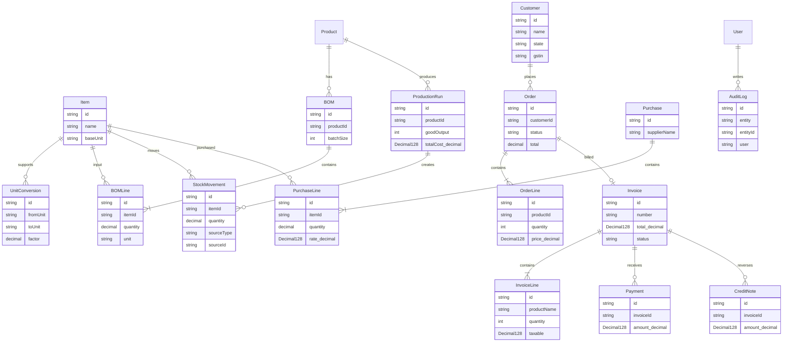

# SmartFactory ERP design note

## Data model

## Computation rules

Stock is the opening balance plus signed `StockMovement` quantities. Purchases create receipt movements and update the moving weighted-average rate. Production creates issue movements for actual BOM consumption and an output movement for good packets. Dispatch creates negative finished-goods movements; credit-note cancellation creates positive reversal movements. Every movement carries a source reference, user and timestamp.

For each production run, planned BOM quantity is multiplied by batch count. Actual quantity is converted to the inventory base unit before deduction. Variance is `(actual - planned) / planned × 100`; absolute variance greater than 3% is flagged. The pouch rule records standard 200, actual 194, damage 6 and return 6 so net stock consumption is 194.

Material cost is actual quantity multiplied by the current weighted-average rate. Labour and gas/power are added to material cost. Cost per packet is total run cost divided by good output, rounded only at the final line with ROUND_HALF_UP. Selling price less cost per packet is profit; profit divided by selling price is margin.

Money uses MongoDB Decimal128 and `decimal.js`; no binary floating-point arithmetic is used for monetary calculations. Quantity conversion uses integer grams/millilitres where fractional units are needed. GST is rounded per invoice line: Tamil Nadu tax is split into half CGST and half SGST, with the remainder assigned to SGST; interstate tax is IGST.
